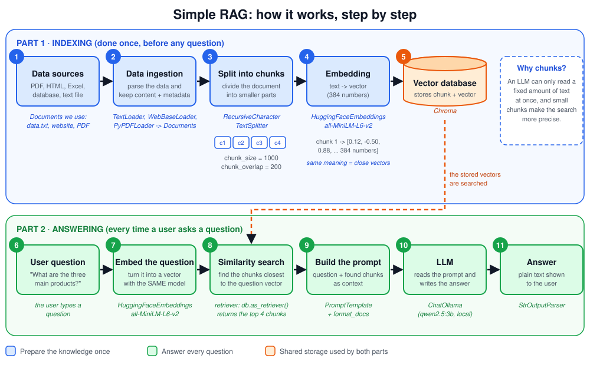
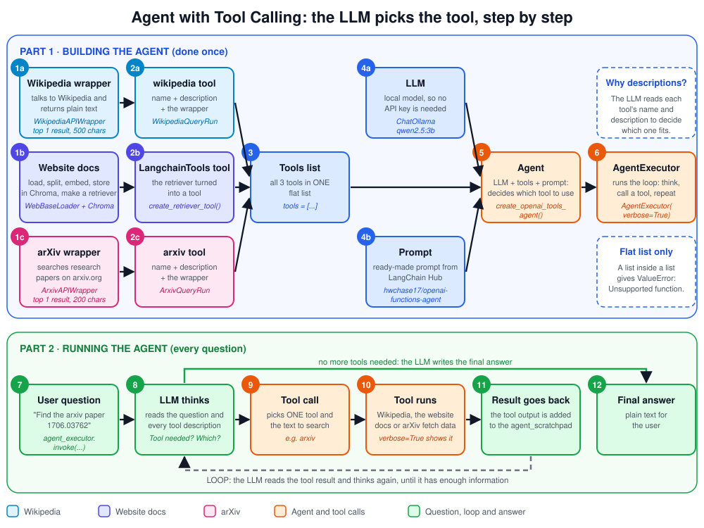
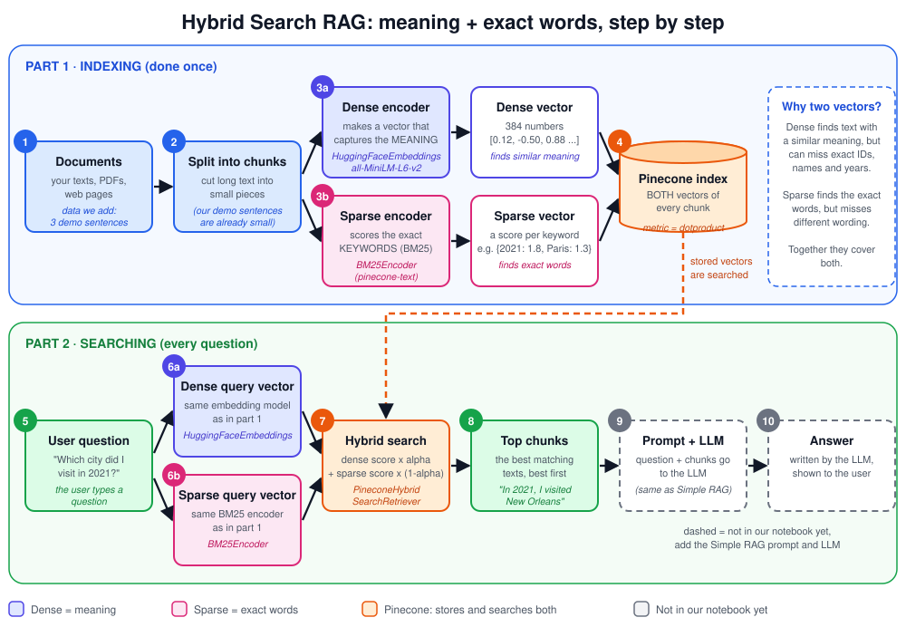
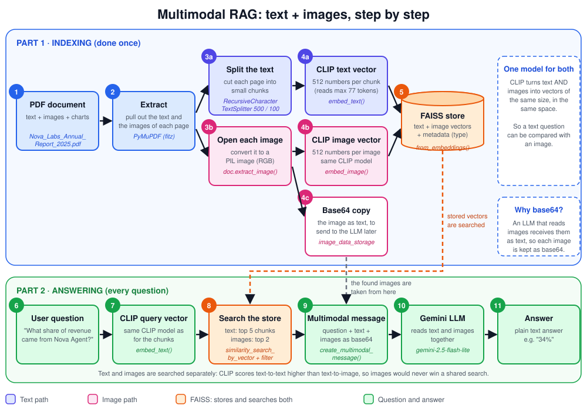

# LangChain Practice Projects

Practice projects for learning RAG (Retrieval-Augmented Generation) and AI agents with LangChain. Each project is a Jupyter notebook that builds one idea step by step, with sample data included so anyone can run it.

## Overview

| # | Project | What it teaches | Runs on |
|---|---|---|---|
| 1 | Simple RAG | The basic RAG pipeline: load, split, embed, store, retrieve, answer | Local (Ollama + Chroma), free |
| 2 | Agents | An LLM that picks between tools (Wikipedia, arXiv, your own documents) | Local (Ollama), free |
| 3 | Hybrid Search RAG | Searching by meaning and by exact words together | Pinecone (free plan) |
| 4 | Multimodal RAG | Answering questions from text **and images or charts** in a PDF | CLIP + FAISS locally, Gemini API |

## Project structure

```
Langchain Practice Projects/
├── rag/
│   ├── simplerag.ipynb          # project 1
│   ├── hybridsearch_rag.ipynb   # project 3
│   ├── multimodel_rag.ipynb     # project 4
│   └── data.txt                 # sample text for project 1
├── Agents/
│   └── agents.ipynb             # project 2
├── Nova_Labs_Company_Profile.pdf     # sample PDF for project 1
├── Nova_Labs_Annual_Report_2025.pdf  # sample PDF with charts for project 4
├── requirements.txt
└── README.md
```

All sample data is about "Nova Labs", a made-up company, so no personal data is in this repository.

## Projects

### 1. Simple RAG (`rag/simplerag.ipynb`)


A question-answering system over my own documents. It runs fully on my own machine, so it costs nothing.

What we built, step by step:
1. **Loaded data** from a text file, a website, and a PDF (a sample company profile, `Nova_Labs_Company_Profile.pdf`).
2. **Split** the text into small chunks.
3. **Embedded** each chunk (turned it into numbers) with a free HuggingFace model.
4. **Stored** the embeddings in Chroma, a vector database.
5. **Retrieved** the chunks closest to a question.
6. **Answered** using a local LLM (Qwen via Ollama), with a prompt template and a chain.

Example: ask "What is the email of Nova Labs?" and it finds the right part of the document and answers from it.

### 2. Agents (`Agents/agents.ipynb`)


A multi-source agent. The LLM reads the question and picks the right tool on its own, then answers from the tool's result. It runs fully on my machine with a local Ollama model, so it costs nothing.

The agent has three tools:
- **Wikipedia tool** for general knowledge (people, places, history).
- **arXiv tool** for research papers.
- **Website retriever tool** that answers questions about the LangChain tools documentation. The page is loaded, split, embedded (HuggingFace), stored in Chroma, and turned into a tool with `create_retriever_tool`.

What we built, step by step:
1. **Built each tool**: a wrapper for Wikipedia and arXiv, and a retriever tool for the website.
2. **Combined** the tools into one list.
3. **Loaded a local LLM** (Qwen via Ollama) instead of a paid API.
4. **Pulled a ready-made prompt** from LangChain Hub (`hwchase17/openai-functions-agent`).
5. **Created the agent** with `create_openai_tools_agent` and ran it with `AgentExecutor`. With `verbose=True` you can watch which tool it chooses.

Example: "Who was Alan Turing?" uses Wikipedia, and "Find the arxiv paper 1706.03762" uses arXiv.

### 3. Hybrid Search RAG (`rag/hybridsearch_rag.ipynb`)


Search that uses **two methods at once**, so it finds text by *meaning* and by *exact words*. It stores everything in Pinecone, a cloud vector database.

Why hybrid? A search by meaning alone is weak on exact things like codes, IDs, names and years. A keyword search alone is weak when people use different words for the same idea. Together they cover both.

| Question | Best search |
|---|---|
| "My app keeps closing by itself" | Meaning (dense) |
| "Error ERR_4021" | Keywords (sparse) |
| "Why does ERR_4021 happen when I log in?" | Both (hybrid) |

Steps:
1. **Create a Pinecone index.** Use `dimension=384` (it must match the embedding model) and `metric="dotproduct"` (the only metric that allows sparse vectors).
2. **Set up dense search** with the free HuggingFace model `all-MiniLM-L6-v2`. It turns text into 384 numbers that capture meaning.
3. **Set up sparse search** with `BM25Encoder` from `pinecone-text`. It scores keywords, and rare words get more weight. `fit()` teaches it the words of your own texts, and `dump()`/`load()` save and reload what it learned.
4. **Connect to the index** with `pc.Index(index_name)`.
5. **Build the retriever** with `PineconeHybridSearchRetriever(embeddings=..., sparse_encoder=..., index=...)`.
6. **Add texts** with `retriever.add_texts([...])`. For each text it makes a dense and a sparse vector and uploads both.
7. **Search** with `retriever.invoke("question")`. It makes both vectors for the question and returns the best matching texts.

Small example:
```python
retriever.add_texts([
    "In 2023, I visited Paris",
    "In 2022, I visited New York",
    "In 2021, I visited New Orleans",
])
retriever.invoke("which city i visited in 2021")
# the top result is "In 2021, I visited New Orleans"
```
The year "2021" matches by keyword, and "which city I visited" matches by meaning. Meaning alone cannot tell the three sentences apart, because they look almost the same to the model.

Notes:
- This notebook needs a Pinecone API key. Put it in `.env` as `Pinecone_API_KEY=`. The free plan is enough.
- The retriever only **finds** texts. To get a written answer, add the same prompt and LLM chain as in Simple RAG.
- For real documents, load and split them into chunks first (like in Simple RAG), and fit the BM25 encoder on those chunks.

### 4. Multimodal RAG (`rag/multimodel_rag.ipynb`)


A normal RAG reads only text. This one also understands the **images and charts** inside a PDF. It answers questions like "What share of revenue came from Nova Agent?" even when that number appears only in a pie chart.

Sample data: `Nova_Labs_Annual_Report_2025.pdf`, a 3-page report with text, a table and four charts (a bar chart, a line chart, a pie chart and a horizontal bar chart). The chart numbers are **not** written in the text, so the system has to read the images.

How it works:
1. **Import the tools.** PyMuPDF opens the PDF, CLIP makes vectors, FAISS stores them, and Gemini answers.
2. **Load CLIP** (`CLIPModel` and `CLIPProcessor`). CLIP turns both text and images into vectors of the same size (512 numbers), so a text question can be compared with an image.
3. **Write two embedding functions**, `embed_text` and `embed_image`. Both return a normalized vector (length 1).
4. **Open the PDF** with PyMuPDF (`fitz.open`).
5. **Process the text.** Take the text of each page, split it into chunks, embed each chunk with CLIP, and keep the page number in the metadata.
6. **Process the images.** Extract every image from the PDF and convert it to a PIL image. Keep it as **base64** text (the LLM needs that format), embed it with CLIP, and add a short label document with `"type": "image"` in the metadata.
7. **Build a FAISS store** from the vectors we already made (`FAISS.from_embeddings`). Text chunks and images live in one store.
8. **Retrieve.** Embed the question with CLIP, then search the **text** and the **images separately** (text top 5, images top 2).
9. **Build a multimodal message.** One message holds the question, the text excerpts and the real images (as base64 data URLs).
10. **Ask Gemini** (`gemini-2.5-flash-lite`), which can read text and images together.
11. **Run the whole pipeline** with `multimodal_pdf_rag_pipeline(question)`. It prints which documents were used and returns the answer.

Example results (tested on the sample report):

| Question | Where the answer is | Answer |
|---|---|---|
| Which quarter had the highest revenue? | Bar chart | Q3, $3.9 million |
| What share of revenue came from Nova Agent? | Pie chart | 34% |
| Which region has the lowest satisfaction score, and what is the 2026 goal? | Chart and text | Latin America (3.8), goal above 4.2 |
| Why was Q4 revenue lower than Q3? | Text | Customers moved annual payments to Q1 2026 |

**Why text and images are searched separately**

The text chunks and the images sit in one FAISS store, so the obvious way is a single search that returns the top 5 of everything. We tried that, and **no image was ever returned**. The reason is that CLIP does not score the two kinds fairly. A question compared with a text chunk gets a score of about **0.7**, but the same question compared with a matching chart gets only about **0.3**. Texts are simply closer to other texts in CLIP's space. This is called the *modality gap*.

So the text chunks always take every top spot, and the charts never reach the LLM, which turns the project back into a normal text-only RAG. For "Which region has the lowest satisfaction score?", the top 5 results were all text chunks, although the answer is in a chart.

The fix is to give each kind its own list, so they don't compete:
1. Search only the **text** chunks and take the top 5 (`filter={"type": "text"}`).
2. Search only the **images** and take the top 2 (`filter={"type": "image"}`).
3. Send both lists to Gemini together.

With this, the right chart came first for every question we tested. The scores of the two lists are never compared with each other, only inside each list, and the order of the images among themselves is correct. The cost is that it always returns 2 images, even when the question doesn't need a chart. Gemini ignores the extra one, and `k_images` can be lowered to 1.

Notes:
- This notebook needs a Gemini API key. Put it in `.env` as `GEMINI_API_KEY=`. The notebook copies it to `GOOGLE_API_KEY`, which is the name the LangChain Gemini package reads.
- The first run downloads the CLIP model (about 600 MB).
- CLIP reads only the first 77 tokens (about 300 characters) of a text. For longer chunks, the end is ignored when the vector is made, but the full text is still stored.
- Page numbers start at 0, so "page 0" is the first page.
- `doc.close()` runs at the end of the image cell. To run the text or image cells again, run the PDF setup cell first.
- Your local Ollama model (`qwen2.5:3b`) cannot read images, so this project uses Gemini. A local vision model such as `llava` would also work.

### 5. Other folders
`api/` and `chatbot/` are empty for now. They are placeholders for later work.

## Setup

```powershell
python -m pip install -r requirements.txt
```

- Use `python -m pip`, because `pip` alone is not on PATH on this machine.
- Put keys in the `.env` file in the project root (for example `OPENAI_API_KEY=`). Never share this file. A local-only setup does not need a key.
- Ollama must be running, with the `qwen2.5:3b` model available.
- The Ollama model runs on CPU (`num_gpu=0`), because the GPU crashed on long prompts.
- In notebooks, run cells from the top after any kernel restart.
- The agents notebook needs `arxiv` older than version 3 (`python -m pip install "arxiv<3"`), because the newest version breaks the LangChain arXiv tool.
- The agents notebook also uses `faiss-cpu`, `langchain`, and `langchainhub`.
- The hybrid search notebook uses `pinecone<7`, `pinecone-text`, and `pinecone-notebooks`. Keep `pinecone` below version 7, because `PineconeHybridSearchRetriever` fails with newer versions.
- The multimodal notebook uses `pymupdf` (imported as `fitz`), `transformers`, `torch`, `pillow`, `scikit-learn` and `langchain-google-genai`. Install `pymupdf`, not the separate PyPI package called `fitz`.
- In LangChain 1.x some old imports moved: use `langchain_core.prompts`, `langchain_core.messages` and `langchain_text_splitters` instead of `langchain.prompts`, `langchain.schema.messages` and `langchain.text_splitter`.
- `pinecone-text` needs the `mmh3` package, which has no ready-made build for Python 3.14 and must be compiled. If the install fails with "Microsoft Visual C++ 14.0 or greater is required", run `python -m pip install --only-binary=:all: mmh3` first, then `python -m pip install --no-deps pinecone-text nltk types-requests`.

---

# Summary of Concepts

## Jupyter Notebook and Kernel
A notebook (`.ipynb`) is code split into cells that you run one at a time, with the output shown below each cell. The **kernel** is the Python process that runs the code, and `ipykernel` is the package that lets Python act as one. Variables stay in memory between cells, so run cells in order. After a restart, run them again from the top.

## Environment and Packages
- `requirements.txt` lists the packages the project needs.
- Install with `python -m pip install -r requirements.txt`. Writing a package in the file does not install it.
- `.env` stores secrets like API keys. `load_dotenv()` reads it, and it searches the notebook's folder and its parent folders.

## RAG (Retrieval-Augmented Generation)
An LLM does not know your private documents. RAG finds the relevant parts of your documents and gives them to the LLM along with the question, so it answers from real data. The steps are: load, split, embed, store, retrieve, answer.

The diagram of this project (see the Projects section above) has two parts:
- **Part 1, indexing (steps 1 to 5):** done once. The data is loaded and parsed into documents (content plus metadata), split into chunks, turned into vectors by the embedding model, and stored in the vector database.
- **Part 2, answering (steps 6 to 11):** done for every question. The question is turned into a vector with the **same** embedding model, a similarity search finds the closest chunks in the vector database, the chunks and the question are put into a prompt, the LLM reads the prompt and writes the answer, and the output parser gives plain text back to the user.

## Document Loaders
Loaders read data and return `Document` objects (text plus metadata).
- `TextLoader` for text files (use `encoding="utf-8"` to avoid garbled characters)
- `WebBaseLoader` for websites
- `PyPDFLoader` for PDFs

## BeautifulSoup (bs4)
`WebBaseLoader` uses bs4 to read a web page's HTML. A `SoupStrainer` picks which tags to keep (for example only `<p>`, or `header` and `footer` too). Images have no text, so the loader skips them.

## Text Splitter (Chunking)
Long text is cut into small pieces so retrieval is precise and the prompt stays short. `RecursiveCharacterTextSplitter` has `chunk_size` (max length of a piece) and `chunk_overlap` (shared text between neighbouring pieces, so no sentence loses its context).

## Embeddings
An embedding model turns text into a list of numbers (a vector) that captures its meaning. Texts with similar meaning get similar vectors. We used the free local model `all-MiniLM-L6-v2`, which gives 384 numbers per text. Always use the same model for the documents and the questions. OpenAI embeddings are paid, but cheap.

## Vector Store (Chroma)
A database that stores chunks together with their vectors and searches by meaning instead of by keyword. `Chroma.from_documents(document, embeddings)` embeds and stores the chunks. `similarity_search(query)` finds the closest ones.

## Retriever
A wrapper around the vector store that returns the most relevant chunks for a question (`db.as_retriever()`). `k` sets how many chunks to return. It only finds chunks and never writes the answer.

## LLM and Ollama
The LLM writes the final answer. Ollama runs models locally, and `langchain-ollama` connects it to LangChain (`ChatOllama`). If Ollama's GPU crashes on long prompts, run on CPU with `num_gpu=0`.

## Prompt Template
A reusable prompt with blanks, such as `{context}` and `{question}`. It is filled in each time, so the instruction stays the same while the data changes.

## Chain
Steps connected with `|`, where each output feeds the next step:
`retriever | format_docs | prompt | llm | StrOutputParser()`

- `format_docs` joins the chunks into one text.
- `StrOutputParser` turns the model reply into plain text.
- The older `create_retrieval_chain` from `langchain.chains` did the same job. It now lives in `langchain_classic`.

## Wrapper
A helper class that hides how an outside service works. `WikipediaAPIWrapper` talks to Wikipedia and returns simple text. A wrapper by itself is not a tool.

## Tools
A tool is a function the LLM can ask to run. It has a name, a description (the LLM reads it to decide when to use the tool), and the function itself. `WikipediaQueryRun` turns the Wikipedia wrapper into a tool. Tools let an LLM get information it was not trained on.

## Agents
An agent is an LLM with tools and a loop. It reads the question, picks a tool, reads the tool's result, and repeats until it can answer. With several tools (Wikipedia, arXiv, a retriever), it picks the best source for each question. Tool calling needs a model that supports it, and small models can be unreliable at it.

The diagram of this project (see the Projects section above) has two parts:
- **Part 1, building the agent (steps 1 to 6):** done once. Each source gets a wrapper and is turned into a **tool** with a name and a description: Wikipedia, the website docs (a retriever turned into a tool) and arXiv. The three tools go into one flat list. The local LLM (Qwen via Ollama), the ready-made prompt from LangChain Hub and the tools are combined into an agent with `create_openai_tools_agent`, and `AgentExecutor` runs it.
- **Part 2, running the agent (steps 7 to 12):** done for every question. The LLM reads the question and the description of every tool, then either picks one tool and the text to search for (a **tool call**) or decides it can answer already. The tool runs, and its result is added to the `agent_scratchpad`. This **loops** until the LLM has enough information, and then it writes the final answer. With `verbose=True` you can watch each step in the notebook output.

The most important point: the LLM never runs a tool itself. It only *chooses* the tool and the input, and the `AgentExecutor` runs the tool and gives the result back.

## Retriever Tool
A retriever can also be given to an agent as a tool with `create_retriever_tool`. You give it a name and a description, such as "useful for questions about LangChain tools". The agent then searches your own documents whenever the question matches that description.

## Wikipedia vs arXiv
- **Wikipedia**: general knowledge.
- **arXiv**: free archive of research papers, for technical and recent topics.

`top_k_results` sets how many results to return, and `doc_content_chars_max` cuts each one to a maximum length. A short result keeps the prompt small, which matters for a small local model.

## User-Agent (Wikipedia 403)
Wikipedia rejects requests that do not say who is sending them. Without a User-Agent the `wikipedia` library gets a 403 error page, and it crashes with a confusing `JSONDecodeError`. The fix is `wikipedia.wikipedia.USER_AGENT = "..."` before creating the tool.

## LangChain Hub
A place to share ready-made prompts. `Client().pull_prompt("owner/name", dangerously_pull_public_prompt=True)` downloads one. The flag is required because a prompt from a stranger could contain unwanted instructions, so you confirm that you trust it. A prompt is only text, so it works with any model, including Ollama.

## Agent and AgentExecutor
- `create_openai_tools_agent(llm, tools, prompt)` builds the agent: the LLM decides which tool to call. The name says "openai", but it works with any model that supports tool calling, such as Qwen in Ollama.
- `AgentExecutor` runs the loop: ask the LLM, run the chosen tool, give the result back, and repeat until there is an answer.
- The prompt has an `agent_scratchpad` slot where the tool calls and results are kept between steps.
- `tools` must be a flat list. A list inside a list gives `ValueError: Unsupported function`.
- In LangChain 1.x these older classes live in `langchain_classic.agents`.
  
## Dense vs Sparse Vectors
- **Dense vector**: a list of numbers (384 here) made by an embedding model. It captures *meaning*, so "car" and "automobile" are close.
- **Sparse vector**: mostly zeros, with a score only for the words that appear in the text. It captures *exact words*, so it is good for names, IDs and codes.

## BM25
A keyword scoring method (an improved TF-IDF). A word gets a higher score when it is rare across your texts and appears in the text. Common words like "the" and "I" get a low score. `BM25Encoder` in `pinecone-text` runs on your computer and costs nothing.

## Hybrid Search
Dense and sparse search run together, and their scores are combined. The `alpha` setting picks the balance: `alpha=1` is meaning only, `alpha=0` is keywords only, and `0.5` is an even mix. Use hybrid when questions can contain both ideas and exact terms.

It is the same idea as Simple RAG, with one difference: **every chunk and every question gets two vectors instead of one**.
- **Part 1, indexing (steps 1 to 4):** done once. The documents are split into chunks. Each chunk goes through two encoders: the dense one (HuggingFace embeddings, which capture the meaning) and the sparse one (BM25, which scores the exact keywords). Pinecone stores both vectors for every chunk.
- **Part 2, searching (steps 5 to 8):** done for every question. The question goes through the same two encoders. The hybrid search compares both question vectors with the stored vectors, combines the scores (`dense x alpha + sparse x (1 - alpha)`), and returns the best chunks.
- **Steps 9 and 10** (prompt, LLM, answer) are the same as in Simple RAG. Our hybrid notebook stops at step 8, so they are shown with dashed lines in the diagram of project 3 (see the Projects section above).

## Pinecone
A cloud vector database. An **index** is one collection of vectors. `ServerlessSpec` sets the cloud and region (here AWS `us-east-1`). The index `dimension` must match the embedding model, and `dotproduct` is required for hybrid search.

## Metadata
Extra information stored with each chunk, such as its page number or type. In the multimodal project, `{"page": 2, "type": "text"}` or `{"type": "image", "image_id": "page_1_img_0"}` tells us what a search result is and where it came from. Metadata can also be used to filter a search.

## Multimodal RAG
RAG that works with more than one kind of data, here **text and images**. A normal RAG can only answer from text, so it fails on facts that appear only in a chart. A multimodal RAG finds the relevant text *and* the relevant pictures, and gives both to an LLM that can see images.

The diagram of this project (see the Projects section above) has two parts:
- **Part 1, indexing (steps 1 to 5):** done once. PyMuPDF pulls the text and the images out of the PDF. The **text path** splits each page into chunks and turns each chunk into a CLIP vector. The **image path** opens each image, turns it into a CLIP vector, and also keeps a base64 copy of it. Both kinds of vectors go into one FAISS store, with metadata that says whether each item is `text` or `image`.
- **Part 2, answering (steps 6 to 11):** done for every question. The question is turned into a CLIP vector with the same model. The store is searched for the best text chunks and, **separately**, the best images. A multimodal message is built from the question, the text and the base64 images (taken from the base64 copies), and Gemini reads all of it together and writes the answer.

The key idea is the same one as in the notes: **one model (CLIP) for both text and images**, so a text question can be compared with an image, and **a multimodal LLM** that can read both at the end.

## CLIP
A model that turns **both text and images into vectors of the same size** (512 numbers) in a shared space. A picture of a bar chart and the words "quarterly revenue" end up close together. That is what lets a text question find an image. Plain text embedding models, like `all-MiniLM-L6-v2`, cannot do this.

## CLIPModel vs CLIPProcessor
- **CLIPProcessor** prepares the input. For images it resizes them to 224×224 and normalizes the colors. For text it cuts the text into tokens. It has no learned weights.
- **CLIPModel** is the neural network that turns the prepared input into the 512 numbers.

You always use both, from the same checkpoint (`openai/clip-vit-base-patch32`).

## Normalizing Vectors and Cosine Similarity
Dividing a vector by its own length makes its length exactly 1. After that, comparing two vectors depends only on their direction, which is what **cosine similarity** measures: 1 means the same direction (very similar), and 0 means unrelated. `torch.no_grad()` tells PyTorch not to prepare for training, so the model runs faster and uses less memory.

## The Modality Gap
CLIP gives much higher scores to text-to-text pairs (about 0.7) than to text-to-image pairs (about 0.3). If text chunks and images share one search, the text always wins and no image is returned. The fix is to search them separately, for example with `filter={"type": "image"}`, and combine the results.

## PyMuPDF (fitz)
A library that opens a PDF and pulls out its text (`page.get_text()`) and its images (`page.get_images()` and `doc.extract_image(xref)`). `PyPDFLoader` reads only text, so it cannot be used for the images. The `xref` is the PDF's internal id of an image.

## Base64 and Data URLs
Base64 turns an image's bytes into plain text. A vision LLM can receive an image as a **data URL**: `data:image/png;base64,<the text>`. We keep each image as base64 in a dictionary (`image_data_storage`) and look it up by its `image_id` after retrieval.

## Multimodal Message
A message to a vision LLM is a **list of parts**, and each part is either text or an image. We build one `HumanMessage` with the question, the text excerpts (labelled with their pages), the retrieved images and a final instruction. The LLM reads all the parts together.

## FAISS with Precomputed Vectors
`FAISS.from_embeddings(text_embeddings=[(text, vector), ...], embedding=None, metadatas=[...])` builds a store from vectors you already made. Because `embedding=None`, text search does not work. Search with your own vector instead: `similarity_search_by_vector(vector, k=...)`. The score is a distance, so lower means closer.

## Gemini and init_chat_model
`init_chat_model("google_genai:gemini-2.5-flash-lite")` loads Google's Gemini through LangChain. It can read text and images, so it is the LLM for the multimodal project. The `langchain-google-genai` package reads the key from `GOOGLE_API_KEY`.

## Choosing the Right Approach

| If you need... | Use |
|---|---|
| Answers from your text documents | Simple RAG |
| Answers from several sources, where the LLM picks the source | Agent with tools |
| Exact words (names, IDs, codes) and meaning together | Hybrid search |
| Answers from charts, diagrams or pictures in documents | Multimodal RAG |
